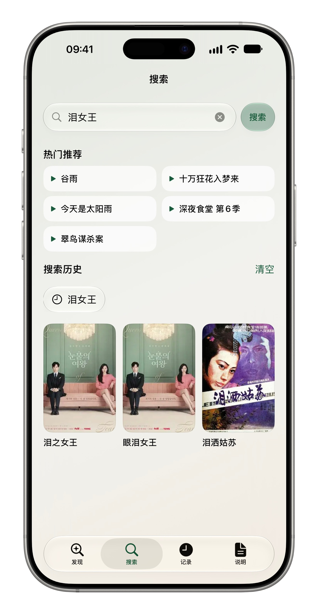
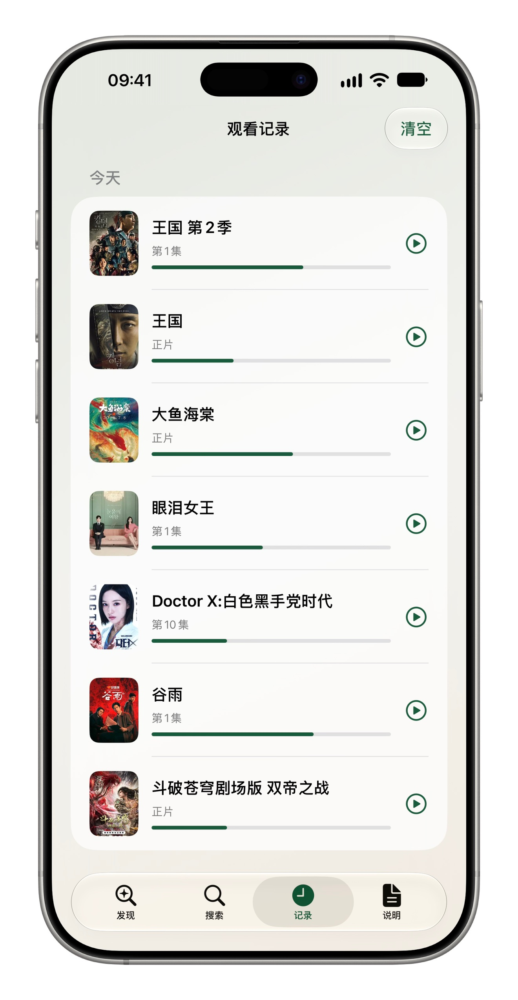
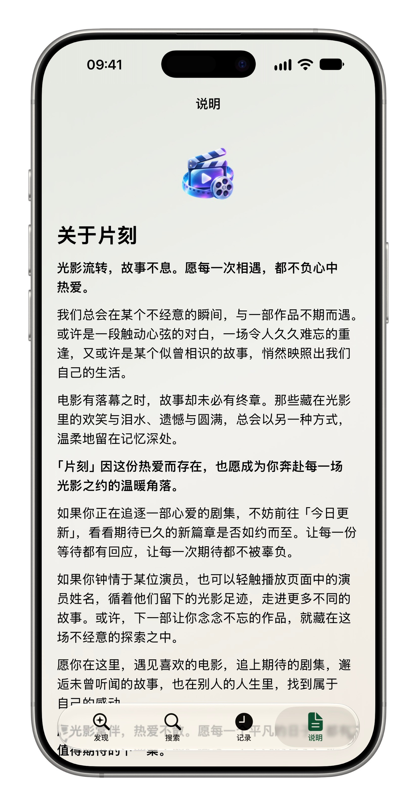

在「今日更新」等一集新剧，沿着喜欢的演员找到下一部电影，也可以回到「记录」，从上次停下的地方继续看。

## 界面预览

## 下载片刻 1.13

| 设备 | 安装包 | 大小 | 安装要求 |
| :--- | :--- | ---: | :--- |
| iPhone、iPad | **[下载 iOS 版 IPA](./downloads/ios/pianke-1.13-unsigned.ipa?raw=true)** | 3.28 MiB | iOS / iPadOS 17.0 及以上，需自行签名 |
| 安卓手机、平板 | **[下载 Android 版 APK](./downloads/android/pianke-1.13.apk?raw=true)** | 153 KiB | Android 8.0 及以上，APK 已签名 |

### 安装

- **iPhone / iPad**　将下载的 IPA 导入支持本地 IPA 的签名安装工具，使用自己的 Apple 开发者签名和匹配的设备描述文件完成签名与安装。如果工具提示需要开发者模式，请按设备提示开启。
- **Android**　在手机上打开下载的 APK，按系统提示安装。如果系统要求授权，请为本次打开文件的浏览器或文件管理器允许「安装未知应用」。播放与搜索使用系统 WebView，建议保持更新。

## 使用指南

| 从哪里开始 | 可以做什么 |
| :--- | :--- |
| **发现** | 浏览推荐分类，或切到「今日更新」，从海报直接打开作品。 |
| **搜索** | 输入片名，或点一个热门推荐。最近搜索保存在本机，可一键清空。 |
| **播放页** | 切换剧集和横屏，使用自动选线或手动选择线路。弹幕默认铺满画面，可调为上方 25%、50%、75%，也可关闭。 |
| **演职员** | 在作品资料里点演员或导演的名字，浏览更多相关作品。 |
| **记录** | 按日期查找看过的作品，点开继续播放，左滑删除单条记录。 |

iPhone 和 iPad 的播放器还提供 **AirPlay** 入口，投屏需要兼容的接收设备和可播放的线路。
